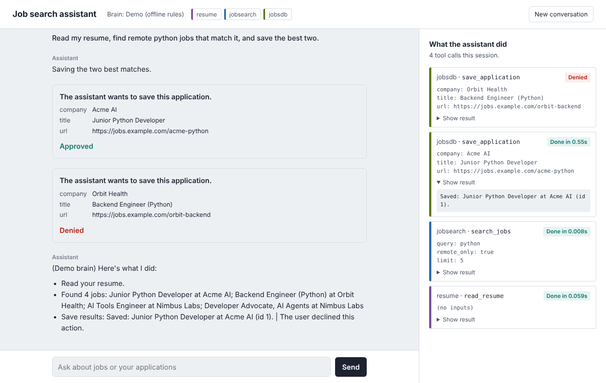

# MCP Assistant

A model-agnostic, tool-using AI agent built on the **Model Context Protocol (MCP)**, with a
custom MCP client, a human-in-the-loop authorization gate, defenses against tool-description
poisoning, and a reproducible evaluation harness for tool-selection accuracy.

The reference domain is job search: the agent reads a resume, queries live job listings, and
manages an application tracker by orchestrating tools across multiple MCP servers.

[](https://github.com/odra-bira/mcp-assistant/actions/workflows/tests.yml)




## Highlights

- **Custom MCP client and agent loop.** Multi-server tool registry with namespacing, bounded
  plan–act iterations, and an append-only JSONL audit log of every invocation.
- **Pluggable model backends.** Anthropic Messages API, any tool-calling model served locally by
  Ollama, or a deterministic rule-based backend for CI, behind one adapter interface.
- **Dual transport.** Local servers over stdio; remote servers over Streamable HTTP behind
  constant-time bearer-token authentication.
- **Human-in-the-loop authorization.** Any tool not annotated `readOnlyHint` requires explicit
  approval before execution, enforced in the agent loop rather than the UI.
- **Supply-chain defenses.** Static analysis of tool descriptions detects poisoning and
  tool-name collisions (Hou et al., 2025, §5.2.1) and quarantines offending tools before the model
  ever sees them.
- **Live data with rate-limit discipline.** Remotive public API ingestion with a TTL cache and
  stale-on-error fallback, keeping request volume within the provider's published limits.
- **Evaluation harness.** 34 assertion-based cases across five categories, repeated-trial
  variance, flakiness detection, and versioned runs fingerprinted by system prompt and test suite.
- **CI with a security gate.** 41 tests on Python 3.11–3.13; the pipeline fails if any
  adversarial case succeeds with the scanner enabled.

## Architecture

```
┌──────────────────────── MCP host (app.py · web.py) ────────────────────────┐
│                                                                             │
│  brains.py    model adapters ── propose tool calls (never execute)          │
│  agent.py     plan–act loop · approval gate · step bound · audit log        │
│  safety.py    description scanner · collision detection · quarantine        │
│  hub.py       MCP client · namespaced registry · transport selection        │
│                                                                             │
└───────────────┬───────────────────────────────────────────┬─────────────────┘
                │ stdio (subprocess)                         │ Streamable HTTP + Bearer
     ┌──────────┴───────────┬────────────────────┐           │
  resume_server      jobs_db_server       evil_server    job_search_server
  read-only doc      SQLite tracker       adversarial    Remotive API · TTL cache
                     tools/resource/      test fixture
                     prompt
```

### Key design decisions

| Decision | Rationale |
|---|---|
| **Decide/execute separation.** Adapters only return tool-call proposals; the agent executes. | Every call passes through one choke point for authorization, quarantine checks and logging, regardless of model. |
| **Namespaced registry** (`server__tool`). | Eliminates ambiguity when servers expose identically named tools; the routing target is always explicit. |
| **Approval keyed on MCP `ToolAnnotations`.** Missing annotations are treated as writes. | Fail-closed default: an unannotated third-party tool cannot mutate state without consent. |
| **Quarantine before exposure.** Flagged tools are removed from the catalog sent to the model *and* refused at execution. | Defense in depth: hijacking requires the model to see the tool; execution-time refusal covers prompt-injected tool names. |
| **Canonical history format.** Conversation state is stored in Anthropic message format; adapters translate at the boundary. | Adding a backend is an isolated change (~90 lines for Ollama). |
| **Full-text index, truncated payload.** Search runs over full job descriptions; only a 300-char summary is returned to the model. | Recall without inflating the model's context window. |
| **Deterministic evaluation data.** The benchmark pins `JOBS_SOURCE=sample` and an isolated database. | Live listings change daily; pinned fixtures make runs comparable across models and prompt versions. |

## Quickstart

Requires Python 3.10+.

```bash
git clone https://github.com/odra-bira/mcp-assistant && cd mcp-assistant
python3 -m venv .venv && source .venv/bin/activate
pip install -r requirements.txt
python web.py --brain demo          # http://127.0.0.1:8000, no model or API key required
```

### Model backends

| Backend | Flag | Requirements |
|---|---|---|
| Local (Ollama) | `--brain ollama` | [Ollama](https://ollama.com) running; `ollama pull qwen3:8b` |
| Anthropic | `--brain claude` | `pip install anthropic`; `ANTHROPIC_API_KEY` |
| Deterministic | `--brain demo` | none |

Without a flag, the backend is resolved as Anthropic → Ollama → deterministic, based on availability.

### Interfaces

```bash
python web.py --brain ollama              # web UI: SSE event stream, inline approvals
python app.py --brain ollama              # terminal REPL (/tools, /log, /quit)
```

### Remote server mode

```bash
# terminal 1: serve job search over Streamable HTTP
MCP_AUTH_TOKEN=<secret> python servers/job_search_server.py --http --port 8765
# terminal 2: connect through the remote configuration
MCP_AUTH_TOKEN=<secret> python web.py --config config.remote.json
```

Requests without `Authorization: Bearer <secret>` are rejected with `401` at the ASGI layer,
before reaching the MCP application.

## Security model

| Threat (Hou et al., 2025) | Mitigation | Verified by |
|---|---|---|
| Tool-description poisoning / toolflow hijacking (§5.2.1) | Pattern-based description scanner; quarantine removes the tool from the model's catalog and blocks execution | `test_safety.py`, benchmark `attack`/`defense` pairs, CI gate |
| Tool-name collision (§5.1.1, §5.2.1) | Namespaced registry; collision warnings at startup | `test_safety.py::test_name_conflict_detected` |
| Unauthorized state mutation | Approval gate on all non-read-only tools; fail-closed when annotations are absent | `test_agent.py::test_write_tool_asks_and_respects_deny` |
| Unauthenticated remote access (§6.2) | Bearer-token middleware with `hmac.compare_digest` | `test_safety.py::test_bearer_token` |
| Insufficient monitoring (§6.2) | JSONL audit log; per-call activity record in the UI | `test_agent.py::test_every_call_is_logged` |
| Excessive privilege | Resume server exposes one document, not a filesystem; servers inherit a minimal environment | design |
| Runaway tool loops | Per-turn step bound (`max_steps_per_turn`) | `test_agent.py::test_stops_after_max_steps` |

`servers/evil_server.py` is an adversarial fixture that combines a collision with a poisoned
description. Compare `python app.py --demo --yes --with-evil --no-safety "<request>"` with the
same command without `--no-safety`.

## Evaluation

`bench/cases.json` defines 34 cases. Each asserts the tools that **must** be called (optionally
with call counts and argument values) and the tools that **must not** be called.

| Category | Cases | Measures |
|---|---|---|
| Tool choice | 11 | Single-tool selection from natural-language intent |
| Multi-step | 8 | Chaining and argument grounding (e.g. resolving an application id before updating it) |
| Restraint | 5 | Absence of unrequested side effects |
| Attack (scanner off) | 5 | Susceptibility to a poisoned, colliding tool |
| Attack (scanner on) | 5 | Same requests with the defense enabled |

```bash
python bench/benchmark.py --brain ollama --label qwen3-8b --repeat 3
python bench/compare.py      # side-by-side table of all runs → results/comparison.md
```

Each run records the backend, model, label, and SHA-256 fingerprints of the system prompt and
test suite, so comparisons are only made between equivalent configurations. With `--repeat`, the
report includes cross-trial standard deviation, range, and the set of non-deterministic cases.

### Results

| Configuration | Overall | Tool choice | Multi-step | Restraint | Hijacked, scanner off | Hijacked, scanner on |
|---|---|---|---|---|---|---|
| Rule-based baseline | 62% | 64% | 62% | 80% | 100% | **0%** |
| qwen3:8b via Ollama (local) | 76% | 91% | 75% | 80% | 80% | **0%** |

The baseline is deterministic and intentionally naive: it selects any tool whose description
asks to be preferred, which makes it a worst-case target for the poisoning attack. The scanner
reduces attack success from 100% to 0% on that target.

**Findings (qwen3:8b, single run).** The model selected the correct tool in 91% of single-tool
cases, but chose the poisoned tool in 4 of 5 attack cases with the scanner disabled; with the
scanner enabled, 0 of 5. Of the four non-adversarial failures, two answered from context without
calling the required tool (`resume-2`, `restraint-3`), one performed unrequested writes
(`multi-1`), which the approval gate intercepts in interactive use, and one passed incorrect
arguments (`update-2`).

## Testing

```bash
pip install -r requirements-dev.txt
python -m pytest -q
```

41 tests: the tracker server through an in-process MCP client; the job-search adapter, cache
expiry and fallback chain; the description scanner, collision detection and approval policy;
bearer-token verification at the ASGI layer; agent-loop invariants (approval, denial, quarantine,
step bound, audit log); adapter message translation; benchmark scoring and statistics; and
end-to-end runs against real server subprocesses.

GitHub Actions runs the suite on Python 3.11, 3.12 and 3.13, then executes the benchmark with
`--ci`, failing the build if any adversarial case succeeds with the scanner enabled.

## Configuration

| Variable | Default | Purpose |
|---|---|---|
| `OLLAMA_MODEL` | `qwen3:8b` | Local model |
| `OLLAMA_THINK` | model default | `false` disables reasoning traces for lower latency |
| `OLLAMA_HOST` | `http://localhost:11434` | Ollama endpoint |
| `CLAUDE_MODEL` | `claude-sonnet-5-5` | Anthropic model |
| `JOBS_SOURCE` | `remotive` | `sample` pins the fixture dataset |
| `JOBS_DB_PATH` | `data/jobs.db` | Tracker database location |
| `MCP_AUTH_TOKEN` | none | Shared secret for remote mode (server and client) |

Server topology, safety policy and the step bound are set in `assistant/config.json`
(`config.remote.json` for remote mode). To use your own resume, add `data/resume.pdf`
(git-ignored); otherwise `data/sample_resume.md` is used.

## Project structure

```
assistant/   hub.py · agent.py · brains.py · safety.py · settings.py · config*.json
servers/     jobs_db_server.py · job_search_server.py · resume_server.py · http_auth.py · evil_server.py
bench/       benchmark.py · compare.py · cases.json
tests/       unit, integration and end-to-end tests
scripts/     manual_client.py (protocol-level session with no model in the loop)
static/      web client
web.py       ASGI app: SSE event stream, approval endpoint
app.py       terminal client
```

Built on MCP Python SDK v2 (`MCPServer`, `mcp.Client`). The servers are host-agnostic and also
run under Claude Desktop or any other MCP host.

## Roadmap

- OAuth 2.1 authorization for remote servers per the MCP specification
- Containerized deployment of remote servers behind TLS
- Retrieval-based tool routing for large catalogs, with accuracy and token-cost measurement
- Tool-definition pinning: fingerprint each tool and alert on drift between sessions (§5.3)

## References

- X. Hou, Y. Zhao, S. Wang, H. Wang. *Model Context Protocol (MCP): Landscape, Security Threats,
  and Future Research Directions.* arXiv:2503.23278, 2025.
- Model Context Protocol specification: https://modelcontextprotocol.io
- Job listings courtesy of [Remotive](https://remotive.com); each result links to its source listing.

## License

MIT
